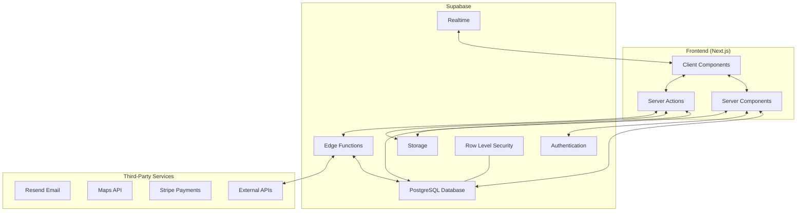

# MyRoomie Global Mobility SaaS Platform

# Comprehensive Implementation Plan

## Table of Contents

1. [Executive Summary](#1-executive-summary)
2. [Business Domain Analysis](#2-business-domain-analysis)
   - [Core Business Domains](#21-core-business-domains)
   - [User Roles & Relationships](#22-user-roles--relationships)
   - [Unique Value Propositions](#23-unique-value-propositions)
3. [Functional Requirements](#3-functional-requirements)
   - [Core Features](#31-core-features)
   - [User Flows](#32-user-flows)
   - [Feature Priorities](#33-feature-priorities)
4. [Technical Architecture](#4-technical-architecture)
   - [Technology Stack](#41-technology-stack)
   - [System Architecture](#42-system-architecture)
   - [Data Model](#43-data-model)
   - [Supabase Integration](#44-supabase-integration)
   - [Security Model](#45-security-model)
5. [UI/UX Design Approach](#5-uiux-design-approach)
   - [Design System](#51-design-system)
   - [User Interfaces by Role](#52-user-interfaces-by-role)
   - [Accessibility Considerations](#53-accessibility-considerations)
6. [Development Implementation](#6-development-implementation)
   - [Server vs Client Components Strategy](#61-server-vs-client-components-strategy)
   - [Database Schema & RLS Policies](#62-database-schema--rls-policies)
   - [Authentication & Authorization](#63-authentication--authorization)
   - [Key Feature Implementation](#64-key-feature-implementation)
7. [Integration Strategy](#7-integration-strategy)
   - [External Service Integrations](#71-external-service-integrations)
   - [API Development](#72-api-development)
   - [Third-party Service Providers](#73-third-party-service-providers)
8. [Implementation Roadmap](#8-implementation-roadmap)
   - [Phased Approach](#81-phased-approach)
   - [Sprint Planning](#82-sprint-planning)
   - [Resource Requirements](#83-resource-requirements)
9. [Testing & Quality Assurance](#9-testing--quality-assurance)
   - [Testing Strategy](#91-testing-strategy)
   - [Performance Metrics](#92-performance-metrics)
   - [Security Testing](#93-security-testing)
10. [Launch & Growth Strategy](#10-launch--growth-strategy)
    - [Go-to-Market Strategy](#101-go-to-market-strategy)
    - [Revenue Models](#102-revenue-models)
    - [Expansion Plan](#103-expansion-plan)
11. [Monitoring & Success Metrics](#11-monitoring--success-metrics)
    - [Key Performance Indicators](#111-key-performance-indicators)
    - [Monitoring Systems](#112-monitoring-systems)
12. [Risk Management](#12-risk-management)
    - [Technical Risks](#121-technical-risks)
    - [Business Risks](#122-business-risks)
    - [Mitigation Strategies](#123-mitigation-strategies)
13. [Future Roadmap](#13-future-roadmap)
    - [Advanced Features](#131-advanced-features)
    - [Scaling Considerations](#132-scaling-considerations)

## 1. Executive Summary

MyRoomie Global Mobility SaaS is a comprehensive platform designed to streamline the relocation process for both corporations and individual employees. The platform creates a unified ecosystem connecting employers, HR managers, relocating employees, real estate professionals, and service providers through a seamless, role-based workflow.

**Key Differentiators:**

- **Dual focus** on corporate management and individual employee experience
- **Flatshare integration** to address affordability and social integration needs
- **End-to-end solution** spanning visa/immigration through final settling-in
- **Serverless architecture** for scalability and reduced operational overhead

**Core Value Propositions:**

- For Corporations: 40% reduction in admin time, compliance assurance, improved employee experience
- For Employees: Self-service guidance with flatshare options, comprehensive marketplace for services
- For Real Estate Professionals: Direct access to qualified relocators, enhanced property management tools
- For Service Providers: New customer acquisition channel, streamlined booking and fulfillment

**Implementation Approach:**
This plan outlines a 12-month phased implementation approach using Next.js 15.x with Supabase for serverless backend infrastructure. The system follows a server-first architecture to optimize performance and security while delivering an exceptional user experience.

## 2. Business Domain Analysis

### 2.1 Core Business Domains

After comprehensive analysis, we've identified these essential business domains:

1. **User Management & Authentication**
   - Multi-role system with fine-grained permissions
   - Unified profiles spanning corporate and individual usage
   - Enterprise SSO options and individual authentication

2. **Housing & Property Management**
   - Property listing, search, and comparison tools
   - Flatshare-specific features and compatibility matching
   - Property importing and portfolio management

3. **Relocation Process Management**
   - Timeline and task tracking customized by destination
   - Status updates and milestone notifications
   - Document collection, verification, and storage

4. **Service Provider Marketplace**
   - Moving services coordination
   - Visa and immigration assistance
   - Utilities, internet, and essential services setup
   - Translation, cultural orientation, and local support

5. **Financial Management**
   - Budget allocation and tracking
   - Expense recording and reimbursement
   - Payment processing and accounting integration

6. **Flatshare Matching & Coordination**
   - Flatmate compatibility algorithm
   - Shared expense tracking and management
   - Group coordination and communication tools
   - Collective property search and selection

7. **Compliance & Legal**
   - Immigration requirement tracking by country
   - Data privacy and GDPR compliance tools
   - Document verification and e-signature
   - Legal templates and guidance

8. **Knowledge & Community**
   - Location-specific resources and guides
   - Community forums and networking
   - FAQs and self-help resources
   - Local culture and integration support

9. **Analytics & Reporting**
   - Relocation metrics and performance tracking
   - Cost analysis and optimization
   - Custom report generation
   - Benchmarking and trend analysis

10. **Emergency & Risk Management**
    - Emergency contact and assistance
    - Insurance and coverage management
    - Risk assessment and mitigation tools

### 2.2 User Roles & Relationships

The platform supports these key user roles with distinct relationships:

| **Role**                    | **Key Actions**                                              | **Relationships**                                         |
|-----------------------------|--------------------------------------------------------------|-----------------------------------------------------------|
| **Employees**               | Set preferences, choose housing, track relocation, book services | Employees ↔ Employers, RE Pros, Service Providers |
| **HR Managers**             | Manage relocations, approvals, budgets, policy enforcement   | HR Managers ↔ Employees, Employers, Service Providers |
| **Employers (Company Admin)**| Set policy, budgets, analytics, assign HR                   | Employers ↔ HR Managers, Platform Admins              |
| **Real Estate Professionals**| List/manage properties, schedule viewings, handle applications | RE Pros ↔ Employees, HR Managers, Service Providers |
| **Service Providers**       | List/manage services, booking management, payment processing | Service Providers ↔ Employees, HR Managers, RE Pros |
| **Platform Administrators** | System-wide oversight, support, global configuration         | Admin ↔ All Roles                                       |

### 2.3 Unique Value Propositions

1. **For Corporations**
   - Centralized relocation management reducing admin time by 40%
   - Compliance assurance with local laws and regulations
   - Improved employee experience and satisfaction
   - Cost transparency and optimization opportunities
   - Rich analytics for policy improvement

2. **For Individual Relocators**
   - Self-service relocation guidance with personalized recommendations
   - Flatshare options for affordability and social integration
   - End-to-end support from visa to settling in
   - Transparent process with clear timeline and expectations
   - Community connection and local knowledge

3. **For Real Estate Professionals**
   - Direct access to qualified relocation clients
   - Efficient property management tools
   - Bulk import capabilities for portfolio management
   - Data insights on relocation trends and preferences
   - Streamlined viewing and application processes

4. **For Service Providers**
   - New customer acquisition channel
   - Simplified booking and fulfillment management
   - Integrated payment processing
   - Performance analytics and feedback
   - Opportunity to specialize in relocation services

## 3. Functional Requirements

### 3.1 Core Features

**User Management & Authentication**

- Role-based user registration and authentication
- Profile management with role-specific information
- Company hierarchy and permission management
- Session management and security controls

**Housing & Property Management**

- Property listing creation and management
- Advanced search with multiple criteria
- Property comparison tools
- Viewing scheduling and feedback collection
- Bulk property import system
- Flatshare-specific property features

**Relocation Process Management**

- Customizable relocation workflow templates
- Task assignment and tracking
- Document management and verification
- Timeline visualization and milestone tracking
- Notification system for status updates

**Flatshare Matching & Coordination**

- Lifestyle compatibility assessment
- Flatmate matching algorithm
- Group formation and management
- Shared expense tracking
- Group messaging and coordination tools
- Collective property search and selection

**Service Provider Marketplace**

- Service listing and discovery
- Category-based organization
- Booking and scheduling system
- Service delivery tracking
- Rating and review system
- Payment processing

**Financial Management**

- Budget allocation by relocation case
- Expense submission and approval workflow
- Receipt processing and storage
- Payment integration
- Reporting and analytics

**Compliance & Risk Management**

- Country-specific requirement tracking
- Document validation against requirements
- Deadline monitoring and alerts
- Privacy compliance tools
- Emergency contact management

**Knowledge & Community**

- Location guides and resources
- Community forums and networking
- FAQ and knowledge base
- Local cultural information

**Analytics & Reporting**

- Dashboard visualization by role
- Custom report generation
- Data export capabilities
- Performance metrics tracking

### 3.2 User Flows

#### Employee Onboarding Flow

1. **Registration/Login**
   - Email/social login or company invitation
   - Basic profile creation

2. **Profile Completion**
   - Personal details and preferences
   - Upload profile photo
   - Set notification preferences

3. **Relocation Details**
   - Destination information
   - Timeline and key dates
   - Connect with employer (optional)

4. **Housing Preferences**
   - Choose individual housing or flatshare
   - Location preferences with map selection
   - Budget range and must-have amenities
   - Lifestyle preferences for flatmate matching

5. **Document Management**
   - Required document checklist
   - Document upload and verification
   - Status tracking

6. **Dashboard & Guidance**
   - Personalized timeline view
   - Recommended next steps
   - Property and service suggestions

#### Flatshare Matching Flow

1. **Flatshare Preference Setup**
   - Lifestyle questionnaire
   - Roommate preferences
   - Shared space priorities

2. **Browse Potential Flatmates**
   - View compatibility scores
   - Filter by preferences
   - Review profiles and interests

3. **Flatmate Communication**
   - In-app messaging
   - Group chat creation
   - Virtual meet-up scheduling

4. **Group Formation**
   - Send/accept group invitations
   - Establish shared preferences
   - Set collective budget

5. **Property Search & Selection**
   - View properties matching group needs
   - Schedule group viewings
   - Collaborative decision-making
   - Apply as a group

6. **Shared Financial Management**
   - Deposit and rent splitting
   - Set up shared expenses
   - Track payments and balances

#### Property Management Flow (Real Estate Professional)

1. **Portfolio Setup**
   - Create property portfolios
   - Set target audience and markets
   - Configure availability and terms

2. **Property Import**
   - Bulk import via CSV/Excel
   - API connection to external systems
   - Validation and error correction
   - Property enrichment and optimization

3. **Listing Management**
   - Individual and batch editing
   - Media management (photos, floorplans)
   - Availability scheduling
   - Pricing and terms setup

4. **Viewing Management**
   - Viewing request handling
   - Scheduling and confirmation
   - Feedback collection
   - Follow-up automation

5. **Application Processing**
   - Receive and review applications
   - Document collection and verification
   - Approval workflow
   - Contract generation and signing

6. **Performance Analytics**
   - Listing performance metrics
   - Conversion rates and bottlenecks
   - Market comparison and optimization

#### Corporate Relocation Management Flow (HR)

1. **Case Initiation**
   - Create relocation case
   - Assign employee and key details
   - Set budget and policy parameters
   - Initiate visa process if needed

2. **Approval Workflows**
   - Review and approve housing selections
   - Approve service bookings
   - Budget exception handling
   - Document verification

3. **Progress Monitoring**
   - Track relocation milestones
   - Identify bottlenecks and issues
   - Provide assistance when needed
   - Generate status reports

4. **Financial Oversight**
   - Budget tracking and allocation
   - Expense approval
   - Payment processing
   - Financial reporting

5. **Case Completion**
   - Final checklist verification
   - Feedback collection
   - Record archiving
   - Performance analytics

### 3.3 Feature Priorities

Features are prioritized using the MoSCoW method (Must have, Should have, Could have, Won't have):

**Must Have (Phase 1)**

- User authentication and role management
- Basic property listing and search
- Housing preference collection
- Document upload and management
- Relocation timeline visualization
- Basic notification system

**Should Have (Phase 2)**

- Flatshare matching algorithm
- Property import system
- Viewing scheduling
- Task management
- Service provider listings
- Budget tracking

**Could Have (Phase 3)**

- Advanced analytics and reporting
- Community forums and resources
- Integration with external systems
- Mobile application
- AI-driven recommendations

**Won't Have (Initial Release)**

- Full-service concierge
- Virtual reality property tours
- Blockchain-based document verification
- Fully automated visa processing

## 4. Technical Architecture

### 4.1 Technology Stack

**Frontend**

- **Framework**: Next.js 15.3.1 (App Router)
- **Language**: TypeScript 5.8.3
- **UI Components**: Custom library built on Shadcn UI / Radix UI
- **Styling**: Tailwind CSS 4.1.4
- **State Management**:
  - Server State: TanStack Query 5.74.6
  - Client State: Zustand 5.0.4
- **Form Handling**: React Hook Form with Zod validation
- **Internationalization**: next-intl
- **Data Visualization**: Recharts 2.0, D3.js

**Backend (Serverless)**

- **Database & Auth**: Supabase
  - PostgreSQL Database with RLS
  - Authentication & Authorization
  - Storage for documents
  - Edge Functions for complex operations
  - Realtime subscriptions for notifications
- **API Architecture**:
  - Server Components for data fetching
  - Server Actions for mutations
  - Edge Functions for complex operations
- **Email Service**: Resend.com
- **Payments**: Stripe
- **Document Processing**: Supabase Storage with OCR via Edge Functions

**DevOps**

- **Hosting**: Vercel
- **Version Control**: GitHub
- **CI/CD**: GitHub Actions with Vercel deployment
- **Monitoring**: Vercel Analytics, Sentry
- **Performance**: Core Web Vitals monitoring

### 4.2 System Architecture

The system follows a modern serverless architecture with clear separation of concerns:



**Key Architectural Principles:**

- **Server-first approach**: Utilize React Server Components for data fetching and initial rendering
- **Security by design**: Implement Row Level Security at the database level
- **Modular structure**: Organize code by feature/domain for maintainability
- **Progressive enhancement**: Ensure core functionality works without JavaScript
- **Mobile-first**: Design responsive interfaces for all device sizes
- **Performance optimization**: Focus on Core Web Vitals and loading performance

### 4.3 Data Model

The database schema will be implemented in Supabase PostgreSQL with these key entities:

**Core Entities**

1. **Users/Profiles**
   - ID, email, first_name, last_name, phone, avatar_url, role[]
   - Relations: employer, employee, real_estate_pro, service_provider

2. **Employers (Companies)**
   - ID, name, industry, size, address, logo, subscription_plan
   - Relations: employees, locations, policies

3. **Employees**
   - ID, employer_id, profile_id, position, department, relocation_budget
   - Relations: housing_preferences, relocations

4. **Properties**
   - ID, owner_id, title, description, type, size, price, address, amenities[]
   - Relations: portfolio, matches, viewings

5. **Housing Preferences**
   - ID, employee_id, property_type, budget_range, locations[], amenities[]
   - Relations: flatshare_preferences

6. **Flatshare Preferences**
   - ID, preference_id, lifestyle_factors, roommate_preferences
   - Relations: flatshare_groups

7. **Flatshare Groups**
   - ID, name, members[], status, budget, created_by
   - Relations: group_preferences, group_chats, property_matches

8. **Relocations**
   - ID, employee_id, origin, destination, status, start_date, end_date
   - Relations: tasks, documents, services, expenses

9. **Tasks**
   - ID, relocation_id, title, description, due_date, status, assignee
   - Relations: documents, services

10. **Services**
    - ID, provider_id, type, title, description, price, availability
    - Relations: bookings, categories

11. **Service Providers**
    - ID, profile_id, company_name, services_offered[], locations[]
    - Relations: services, bookings

12. **Documents**
    - ID, relocation_id, type, file_path, status, expiry_date
    - Relations: tasks, approvals

13. **Expenses**
    - ID, relocation_id, category, amount, currency, status, receipt_url
    - Relations: approvals, payments

14. **PropertyMatches**
    - ID, property_id, employee_id/flatshare_group_id, match_score, status
    - Relations: viewings, applications

### 4.4 Supabase Integration

**Authentication**

```typescript
// lib/supabase/client.ts
import { createBrowserClient } from '@supabase/ssr';
import { Database } from '@/types/supabase';

export const createClient = () => {
  return createBrowserClient<Database>(
    process.env.NEXT_PUBLIC_SUPABASE_URL!,
    process.env.NEXT_PUBLIC_SUPABASE_ANON_KEY!
  );
};

// lib/supabase/server.ts
import { createServerClient } from '@supabase/ssr';
import { cookies } from 'next/headers';
import { Database } from '@/types/supabase';

export async function createClient() {
  const cookieStore = await cookies();

  return createServerClient<Database>(
    process.env.NEXT_PUBLIC_SUPABASE_URL!,
    process.env.NEXT_PUBLIC_SUPABASE_ANON_KEY!,
    {
      cookies: {
        get(name) {
          return cookieStore.get(name)?.value;
        },
        set(name, value, options) {
          cookieStore.set({ name, value, ...options });
        },
        remove(name, options) {
          cookieStore.set({ name, value: '', ...options });
        },
      },
    }
  );
}
```

**Real-time Features**

```typescript
// hooks/usePropertyUpdates.ts
import { useEffect, useState } from 'react';
import { createClient } from '@/lib/supabase/client';

export function usePropertyUpdates(propertyId: string) {
  const [updates, setUpdates] = useState([]);
  const supabase = createClient();

  useEffect(() => {
    const channel = supabase
      .channel(`property-${propertyId}`)
      .on('postgres_changes',
        {
          event: '*',
          schema: 'public',
          table: 'properties',
          filter: `id=eq.${propertyId}`
        },
        (payload) => {
          // Handle property updates
          setUpdates(prev => [...prev, payload.new]);
        }
      )
      .subscribe();

    return () => {
      supabase.removeChannel(channel);
    };
  }, [propertyId]);

  return updates;
}
```

**Edge Functions**

```typescript
// Example Supabase Edge Function for complex operations
// supabase/functions/match-properties/index.ts
import { serve } from 'https://deno.land/std@0.168.0/http/server.ts';
import { createClient } from 'https://esm.sh/@supabase/supabase-js@2.7.1';

interface MatchResult {
  propertyId: string;
  score: number;
  reasons: {
    factor: string;
    score: number;
    maxScore: number;
  }[];
}

serve(async (req) => {
  const supabase = createClient(
    Deno.env.get('SUPABASE_URL') ?? '',
    Deno.env.get('SUPABASE_ANON_KEY') ?? '',
    { global: { headers: { Authorization: req.headers.get('Authorization')! } } }
  );

  const { employeeId } = await req.json();

  // Implement matching algorithm here
  // This would include fetching preferences, properties,
  // calculating match scores, and returning results

  const matches: MatchResult[] = []; // Calculated matches

  return new Response(
    JSON.stringify(matches),
    { headers: { 'Content-Type': 'application/json' } },
  );
});
```

### 4.5 Security Model

**Row Level Security (RLS) Policies**

```sql
-- Enable RLS on properties table
ALTER TABLE properties ENABLE ROW LEVEL SECURITY;

-- HR Managers can see all company properties
CREATE POLICY "HR Managers can view company properties" ON properties
  FOR SELECT USING (
    auth.jwt() ->> 'role' = 'hr_manager' AND
    employer_id = (SELECT employer_id FROM profiles WHERE id = auth.uid())
  );

-- Employees can see matched properties
CREATE POLICY "Employees can view matched properties" ON properties
  FOR SELECT USING (
    auth.jwt() ->> 'role' = 'employee' AND
    id IN (
      SELECT property_id FROM property_matches
      WHERE employee_id = (SELECT employee_id FROM profiles WHERE id = auth.uid())
      AND status IN ('visible', 'interested', 'scheduled', 'visited', 'selected')
    )
  );

-- Real Estate Professionals can manage their properties
CREATE POLICY "Real Estate Pros can manage their properties" ON properties
  USING (
    auth.jwt() ->> 'role' = 'real_estate_pro' AND
    real_estate_pro_id = (SELECT realestate_id FROM profiles WHERE id = auth.uid())
  );
```

**Authentication Security**

- JWT-based authentication with proper token handling
- Role-based access control at application and database levels
- Two-factor authentication for high-privilege roles
- Session management with proper timeout and refresh mechanisms

**Data Security**

- Encryption at rest for sensitive data
- Secure file storage with access controls
- Input validation and sanitization
- Protection against common vulnerabilities (XSS, CSRF, etc.)

**Compliance**

- GDPR compliance features
- Data minimization principles
- Audit logging for sensitive operations
- Data retention policies

## 5. UI/UX Design Approach

### 5.1 Design System

**Color Scheme**

- **Primary**: #1A73E8 (Trust blue)
- **Secondary**: #34A853 (Success green)
- **Accent**: #FBBC04 (Attention yellow)
- **Error**: #EA4335 (Alert red)
- **Neutrals**: #FFFFFF, #F8F9FA, #DADCE0, #5F6368, #202124

**Typography**

- **Headings**: Inter (600, 700)
- **Body**: Inter (400, 500)
- **Monospace**: Roboto Mono (for code/technical content)

**Component Library**

- Custom component library built on Shadcn UI
- Consistent interaction patterns
- Themeable and customizable
- Responsive behaviors for all screen sizes

**Design Principles**

- **Clarity**: Clear information hierarchy and visual organization
- **Efficiency**: Minimize steps and cognitive load
- **Consistency**: Uniform patterns and behaviors
- **Feedback**: Clear system status and user confirmation
- **Accessibility**: WCAG AA compliance minimum

### 5.2 User Interfaces by Role

#### Employee Dashboard

**Key Sections:**

- Relocation progress visualization
- Upcoming tasks and deadlines
- Property recommendations and matches
- Service marketplace and bookings
- Document status and uploads needed
- Expense tracking and submission
- Community resources and guides

**Specialized Views:**

- Flatshare matching and management
- Property comparison tools
- Viewing scheduling interface
- Document upload and verification
- Service booking workflow

#### HR Manager Dashboard

**Key Sections:**

- Company-wide relocation overview
- Employee management and status
- Task approval queue
- Budget and expense tracking
- Document verification workflows
- Performance metrics and analytics
- Policy management and templates

**Specialized Views:**

- Employee relocation detail view
- Property approval interface
- Expense approval workflow
- Reporting and analytics tools
- Service provider management

#### Real Estate Professional Dashboard

**Key Sections:**

- Property portfolio overview
- Listing performance metrics
- Viewing schedule and management
- Prospect inquiries and applications
- Document and lease management
- Market insights and demand analytics

**Specialized Views:**

- Property import interface
- Property detail editor
- Viewing calendar
- Application processing
- Lease generation and management

#### Service Provider Dashboard

**Key Sections:**

- Service listing management
- Booking calendar and scheduling
- Service delivery tracking
- Customer communication
- Payment processing and history
- Performance analytics

**Specialized Views:**

- Service editor
- Availability management
- Booking detail view
- Customer management
- Review and feedback analysis

### 5.3 Accessibility Considerations

- WCAG AA compliance as minimum standard
- Color contrast ratio of at least 4.5:1
- Keyboard navigation support
- Screen reader compatibility
- Focus management for modals and notifications
- Responsive design for all screen sizes
- Alternative text for images and media
- Form labels and error messages
- Proper heading structure and landmarks

## 6. Development Implementation

### 6.1 Server vs Client Components Strategy

Following Next.js 15.x best practices:

**Server Components (Default)**

- Data fetching and initial rendering
- Static content and SEO-critical pages
- Form submissions with Server Actions
- Pages that don't require client interactivity

```typescript
// app/dashboard/page.tsx (Server Component)
import { Suspense } from 'react';
import { PropertyListContainer } from './property-list.server';
import { PropertyFilters } from './property-filters.client';
import { LoadingSkeleton } from '@/components/ui/loading-skeleton';

export default async function DashboardPage() {
  return (
    <main className="container py-8">
      <h1 className="text-3xl font-bold mb-6">Your Dashboard</h1>
      <PropertyFilters /> {/* Client component for interactive filters */}
      <Suspense fallback={<LoadingSkeleton />}>
        <PropertyListContainer /> {/* Server component for data fetching */}
      </Suspense>
    </main>
  );
}
```

**Client Components**

- Interactive UI elements
- Components that use browser APIs
- Real-time updates and notifications
- Forms with immediate validation

```typescript
// components/property-filters.client.tsx
'use client';

import { useState } from 'react';
import { useRouter, useSearchParams } from 'next/navigation';
import { Button } from '@/components/ui/button';
import { Input } from '@/components/ui/input';
import { Slider } from '@/components/ui/slider';

export function PropertyFilters() {
  const router = useRouter();
  const searchParams = useSearchParams();
  const [priceRange, setPriceRange] = useState([0, 5000]);

  // Filter handling logic

  return (
    <div className="bg-white rounded-lg p-4 mb-6 shadow-sm">
      <h2 className="text-lg font-medium mb-4">Filter Properties</h2>
      <div className="grid grid-cols-1 md:grid-cols-3 gap-4">
        {/* Filter controls */}
        <Button onClick={applyFilters}>Apply Filters</Button>
      </div>
    </div>
  );
}
```

### 6.2 Database Schema & RLS Policies

Example schema implementation for key tables:

**Profiles Table**

```sql
CREATE TABLE profiles (
  id UUID PRIMARY KEY REFERENCES auth.users(id) ON DELETE CASCADE,
  first_name TEXT,
  last_name TEXT,
  email TEXT UNIQUE NOT NULL,
  phone TEXT,
  avatar_url TEXT,
  role TEXT[] NOT NULL CHECK (role <@ ARRAY['superadmin', 'admin', 'hrmanager', 'employer', 'employee', 'realestatepro', 'serviceprovider']),
  employer_id UUID REFERENCES employers(id) ON DELETE SET NULL,
  employee_id UUID REFERENCES employees(id) ON DELETE SET NULL,
  realestate_id UUID REFERENCES real_estate_pros(id) ON DELETE SET NULL,
  serviceprovider_id UUID REFERENCES service_providers(id) ON DELETE SET NULL,
  is_active BOOLEAN DEFAULT TRUE,
  created_at TIMESTAMPTZ DEFAULT CURRENT_TIMESTAMP,
  updated_at TIMESTAMPTZ DEFAULT CURRENT_TIMESTAMP
);

-- RLS Policies
ALTER TABLE profiles ENABLE ROW LEVEL SECURITY;

-- Users can read their own profile
CREATE POLICY "Users can read own profile" ON profiles
  FOR SELECT USING (auth.uid() = id);

-- Users can update their own profile
CREATE POLICY "Users can update own profile" ON profiles
  FOR UPDATE USING (auth.uid() = id);

-- Admins and SuperAdmins can read all profiles
CREATE POLICY "Admins can read all profiles" ON profiles
  FOR SELECT USING (
    'admin' = ANY(auth.jwt() ->> 'role') OR
    'superadmin' = ANY(auth.jwt() ->> 'role')
  );
```

**Properties Table**

```sql
CREATE TABLE properties (
  id UUID PRIMARY KEY DEFAULT uuid_generate_v4(),
  portfolio_id UUID REFERENCES property_portfolios(id) ON DELETE CASCADE,
  employer_id UUID REFERENCES employers(id) ON DELETE CASCADE,
  real_estate_pro_id UUID REFERENCES real_estate_pros(id) ON DELETE SET NULL,
  title TEXT NOT NULL,
  description TEXT,
  property_type TEXT,
  bedrooms INTEGER,
  bathrooms INTEGER,
  size DECIMAL(10,2),
  price DECIMAL(10,2) NOT NULL,
  security_deposit DECIMAL(10,2),
  address TEXT,
  city TEXT,
  state TEXT,
  postal_code TEXT,
  country TEXT,
  latitude DECIMAL(10,6),
  longitude DECIMAL(10,6),
  amenities TEXT[],
  photos TEXT[],
  floor_plan_url TEXT,
  availability_date DATE,
  lease_term TEXT,
  pet_policy TEXT,
  is_furnished BOOLEAN DEFAULT FALSE,
  is_suitable_for_flatshare BOOLEAN DEFAULT FALSE,
  max_flatmates INTEGER,
  is_available BOOLEAN DEFAULT TRUE,
  is_featured BOOLEAN DEFAULT FALSE,
  is_active BOOLEAN DEFAULT TRUE,
  created_at TIMESTAMPTZ DEFAULT CURRENT_TIMESTAMP,
  updated_at TIMESTAMPTZ DEFAULT CURRENT_TIMESTAMP,
  created_by UUID REFERENCES profiles(id),
  updated_by UUID REFERENCES profiles(id)
);

-- RLS Policies
ALTER TABLE properties ENABLE ROW LEVEL SECURITY;

-- SuperAdmins and Admins can do everything
CREATE POLICY "SuperAdmins and Admins have full access to properties" ON properties
  USING (
    'admin' = ANY(auth.jwt() ->> 'role') OR
    'superadmin' = ANY(auth.jwt() ->> 'role')
  );

-- HR Managers can read and write properties for their company
CREATE POLICY "HR Managers can manage company properties" ON properties
  USING (
    'hrmanager' = ANY(auth.jwt() ->> 'role') AND
    employer_id = (SELECT employer_id FROM profiles WHERE id = auth.uid())
  );
```

**Housing Preferences Table**

```sql
CREATE TABLE housing_preferences (
  id UUID PRIMARY KEY DEFAULT uuid_generate_v4(),
  employee_id UUID REFERENCES employees(id) ON DELETE CASCADE,
  property_type TEXT,
  min_bedrooms INTEGER,
  min_bathrooms INTEGER,
  min_size DECIMAL(10,2),
  min_price DECIMAL(10,2),
  max_price DECIMAL(10,2),
  preferred_locations TEXT[],
  required_amenities TEXT[],
  nice_to_have_amenities TEXT[],
  max_commute_distance DECIMAL(10,2),
  commute_type TEXT,
  pet_friendly BOOLEAN DEFAULT FALSE,
  family_friendly BOOLEAN DEFAULT FALSE,
  preferred_lease_term TEXT,
  move_in_date DATE,
  flatshare_interest BOOLEAN DEFAULT FALSE,
  notes TEXT,
  created_at TIMESTAMPTZ DEFAULT CURRENT_TIMESTAMP,
  updated_at TIMESTAMPTZ DEFAULT CURRENT_TIMESTAMP
);

-- RLS Policies
ALTER TABLE housing_preferences ENABLE ROW LEVEL SECURITY;

-- Users can read and update their own preferences
CREATE POLICY "Users can manage own preferences" ON housing_preferences
  USING (
    employee_id = (SELECT employee_id FROM profiles WHERE id = auth.uid())
  );

-- HR Managers can read preferences for their company's employees
CREATE POLICY "HR Managers can view company preferences" ON housing_preferences
  FOR SELECT USING (
    'hrmanager' = ANY(auth.jwt() ->> 'role') AND
    employee_id IN (
      SELECT id FROM employees WHERE employer_id = (
        SELECT employer_id FROM profiles WHERE id = auth.uid()
      )
    )
  );
```

### 6.3 Authentication & Authorization

**Authentication Setup**

```typescript
// middleware.ts
import { createMiddlewareClient } from '@supabase/auth-helpers-nextjs';
import { NextResponse } from 'next/server';
import type { NextRequest } from 'next/server';

export async function middleware(req: NextRequest) {
  const res = NextResponse.next();
  const supabase = createMiddlewareClient({ req, res });

  const {
    data: { session },
  } = await supabase.auth.getSession();

  // Check if user is authenticated for protected routes
  if (!session && req.nextUrl.pathname.startsWith('/dashboard')) {
    const redirectUrl = new URL('/login', req.url);
    redirectUrl.searchParams.set('redirectedFrom', req.nextUrl.pathname);
    return NextResponse.redirect(redirectUrl);
  }

  return res;
}

export const config = {
  matcher: [
    '/dashboard/:path*',
    '/properties/:path*',
    '/services/:path*',
    '/admin/:path*',
    '/api/:path*',
  ],
};
```

**Role-Based Access Control**

```typescript
// lib/auth.ts
import { createServerClient } from '@/lib/supabase/server';

export async function hasRole(roles: string[]) {
  const supabase = await createServerClient();

  const { data: { session } } = await supabase.auth.getSession();

  if (!session) {
    return false;
  }

  const userRoles = session.user?.app_metadata?.roles || [];

  return roles.some(role => userRoles.includes(role));
}

// components/role-guard.client.tsx
'use client';

import { useEffect, useState } from 'react';
import { useRouter } from 'next/navigation';
import { createClient } from '@/lib/supabase/client';

interface RoleGuardProps {
  allowedRoles: string[];
  children: React.ReactNode;
  fallback?: React.ReactNode;
}

export function RoleGuard({ allowedRoles, children, fallback }: RoleGuardProps) {
  const [hasAccess, setHasAccess] = useState<boolean | null>(null);
  const router = useRouter();
  const supabase = createClient();

  useEffect(() => {
    async function checkRole() {
      const { data: { session } } = await supabase.auth.getSession();

      if (!session) {
        router.push('/login');
        return;
      }

      const userRoles = session.user?.app_metadata?.roles || [];
      const hasPermission = allowedRoles.some(role => userRoles.includes(role));

      setHasAccess(hasPermission);

      if (!hasPermission && !fallback) {
        router.push('/unauthorized');
      }
    }

    checkRole();
  }, [allowedRoles, router]);

  if (hasAccess === null) {
    return <div>Loading...</div>;
  }

  if (hasAccess === false) {
    return fallback || null;
  }

  return <>{children}</>;
}
```

### 6.4 Key Feature Implementation

**Property Import System**

```typescript
// app/actions/import-properties.ts
'use server';

import { z } from 'zod';
import { createServerClient } from '@/lib/supabase/server';
import { revalidatePath } from 'next/cache';

// Validation schema for property data
const propertySchema = z.object({
  title: z.string().min(3).max(100),
  description: z.string().optional(),
  property_type: z.string(),
  bedrooms: z.number().int().min(0),
  bathrooms: z.number().min(0),
  size: z.number().min(0).optional(),
  price: z.number().min(0),
  // Additional fields...
});

export async function importProperties(formData: FormData) {
  const file = formData.get('file') as File;
  const portfolioId = formData.get('portfolioId') as string;

  if (!file || !portfolioId) {
    throw new Error('Missing required fields');
  }

  // Create import job record
  const supabase = await createServerClient();

  const { data: user } = await supabase.auth.getUser();

  if (!user) {
    throw new Error('Unauthorized');
  }

  const { data: importJob, error: jobError } = await supabase
    .from('import_jobs')
    .insert({
      user_id: user.user.id,
      source: 'excel',
      status: 'processing',
      file_name: file.name,
      file_size: file.size,
    })
    .select()
    .single();

  if (jobError) {
    throw new Error(`Failed to create import job: ${jobError.message}`);
  }

  // Process file content (simplified)
  const fileContent = await file.text();
  const rows = parseCSV(fileContent); // Implement CSV parsing

  let successCount = 0;
  let errorCount = 0;

  // Process each row
  for (const row of rows) {
    try {
      // Validate row data
      const validatedData = propertySchema.parse(row);

      // Insert property
      const { error } = await supabase
        .from('properties')
        .insert({
          ...validatedData,
          portfolio_id: portfolioId,
          created_by: user.user.id,
        });

      if (error) {
        // Log error and continue
        await supabase
          .from('import_job_errors')
          .insert({
            import_job_id: importJob.id,
            record_data: row,
            error_message: error.message,
          });

        errorCount++;
      } else {
        successCount++;
      }
    } catch (error) {
      // Handle validation errors
      await supabase
        .from('import_job_errors')
        .insert({
          import_job_id: importJob.id,
          record_data: row,
          error_message: error.message || 'Unknown error',
        });

      errorCount++;
    }
  }

  // Update import job status
  await supabase
    .from('import_jobs')
    .update({
      status: 'completed',
      total_records: rows.length,
      valid_records: successCount,
      invalid_records: errorCount,
      completed_at: new Date().toISOString(),
    })
    .eq('id', importJob.id);

  revalidatePath('/properties/portfolio');

  return {
    jobId: importJob.id,
    totalCount: rows.length,
    successCount,
    errorCount,
  };
}

// Helper function to parse CSV (simplified)
function parseCSV(content: string) {
  // Implement CSV parsing logic
  // Return array of objects representing rows
  return [];
}
```

**Matching Algorithm**

```typescript
// lib/matching-algorithm.ts
import { createServerClient } from '@/lib/supabase/server';

interface MatchResult {
  propertyId: string;
  score: number;
  reasons: {
    factor: string;
    score: number;
    maxScore: number;
  }[];
}

export async function matchPropertiesForEmployee(employeeId: string): Promise<MatchResult[]> {
  const supabase = await createServerClient();

  // Fetch employee preferences
  const { data: preferences } = await supabase
    .from('housing_preferences')
    .select('*')
    .eq('employee_id', employeeId)
    .single();

  if (!preferences) {
    throw new Error('Housing preferences not found');
  }

  // Fetch available properties
  const { data: properties } = await supabase
    .from('properties')
    .select('*')
    .eq('is_available', true)
    .gte('price', preferences.min_price || 0)
    .lte('price', preferences.max_price || 999999)
    .gte('bedrooms', preferences.min_bedrooms || 0);

  if (!properties || properties.length === 0) {
    return [];
  }

  // Calculate match scores
  const results: MatchResult[] = properties.map(property => {
    // Budget match (30%)
    const budgetMatch = calculateBudgetMatch(property.price, preferences);

    // Location match (30%)
    const locationMatch = calculateLocationMatch(
      property.latitude,
      property.longitude,
      preferences.preferred_locations
    );

    // Feature match (40%)
    const featureMatch = calculateFeatureMatch(
      property.amenities,
      preferences.required_amenities,
      preferences.nice_to_have_amenities
    );

    // Calculate total score
    const totalScore = (
      (budgetMatch.score * 0.3) +
      (locationMatch.score * 0.3) +
      (featureMatch.score * 0.4)
    );

    return {
      propertyId: property.id,
      score: Math.round(totalScore * 100),
      reasons: [
        { factor: 'Budget', ...budgetMatch },
        { factor: 'Location', ...locationMatch },
        { factor: 'Features', ...featureMatch },
      ]
    };
  });

  // Sort by score (highest first)
  return results.sort((a, b) => b.score - a.score);
}

// Helper functions for score calculation
function calculateBudgetMatch(price: number, preferences: any) {
  // Calculate how well the price matches the budget range
  const { min_price, max_price } = preferences;

  // If price is within range, perfect score
  if (price >= min_price && price <= max_price) {
    return { score: 1, maxScore: 1 };
  }

  // If below min, calculate percentage below
  if (price < min_price) {
    const percentBelow = price / min_price;
    return { score: percentBelow, maxScore: 1 };
  }

  // If above max, calculate how far above
  const percentAbove = max_price / price;
  return { score: percentAbove, maxScore: 1 };
}

function calculateLocationMatch(
  lat: number,
  lng: number,
  preferredLocations: any[]
) {
  // Implementation would use distance calculations
  // and preferred location matching
  return { score: 0.8, maxScore: 1 }; // Placeholder
}

function calculateFeatureMatch(
  amenities: string[],
  requiredAmenities: string[],
  niceToHaveAmenities: string[]
) {
  // Calculate required amenities match (70%)
  const requiredScore = requiredAmenities.length > 0
    ? requiredAmenities.filter(a => amenities.includes(a)).length / requiredAmenities.length
    : 1;

  // Calculate nice-to-have amenities match (30%)
  const niceToHaveScore = niceToHaveAmenities.length > 0
    ? niceToHaveAmenities.filter(a => amenities.includes(a)).length / niceToHaveAmenities.length
    : 1;

  const totalScore = (requiredScore * 0.7) + (niceToHaveScore * 0.3);

  return { score: totalScore, maxScore: 1 };
}
```

**Flatshare Matching**

```typescript
// lib/flatshare-matching.ts
import { createServerClient } from '@/lib/supabase/server';

interface FlatmateMatch {
  userId: string;
  score: number;
  compatibilityFactors: {
    factor: string;
    score: number;
    maxScore: number;
  }[];
}

export async function matchPotentialFlatmates(userId: string): Promise<FlatmateMatch[]> {
  const supabase = await createServerClient();

  // Fetch user's flatshare preferences
  const { data: userPreferences } = await supabase
    .from('flatshare_preferences')
    .select(`
      id,
      lifestyle_factors,
      cleanliness,
      noise_tolerance,
      guest_preference,
      sleep_schedule,
      sharing_preference,
      interests,
      housing_preferences!inner(
        employee_id,
        min_price,
        max_price,
        preferred_locations,
        move_in_date
      )
    `)
    .eq('housing_preferences.employee_id', userId)
    .single();

  if (!userPreferences) {
    throw new Error('Flatshare preferences not found');
  }

  // Fetch other users with flatshare interest
  const { data: potentialMatches } = await supabase
    .from('flatshare_preferences')
    .select(`
      id,
      lifestyle_factors,
      cleanliness,
      noise_tolerance,
      guest_preference,
      sleep_schedule,
      sharing_preference,
      interests,
      housing_preferences!inner(
        employee_id,
        min_price,
        max_price,
        preferred_locations,
        move_in_date
      )
    `)
    .neq('housing_preferences.employee_id', userId);

  if (!potentialMatches || potentialMatches.length === 0) {
    return [];
  }

  // Calculate compatibility scores
  const matches: FlatmateMatch[] = potentialMatches.map(match => {
    // Calculate lifestyle compatibility (40%)
    const lifestyleScore = calculateLifestyleCompatibility(
      userPreferences.lifestyle_factors,
      match.lifestyle_factors
    );

    // Calculate budget compatibility (30%)
    const budgetScore = calculateBudgetCompatibility(
      userPreferences.housing_preferences.min_price,
      userPreferences.housing_preferences.max_price,
      match.housing_preferences.min_price,
      match.housing_preferences.max_price
    );

    // Calculate location compatibility (20%)
    const locationScore = calculateLocationCompatibility(
      userPreferences.housing_preferences.preferred_locations,
      match.housing_preferences.preferred_locations
    );

    // Calculate timing compatibility (10%)
    const timingScore = calculateTimingCompatibility(
      userPreferences.housing_preferences.move_in_date,
      match.housing_preferences.move_in_date
    );

    // Calculate total compatibility score
    const totalScore = (
      (lifestyleScore.score * 0.4) +
      (budgetScore.score * 0.3) +
      (locationScore.score * 0.2) +
      (timingScore.score * 0.1)
    );

    return {
      userId: match.housing_preferences.employee_id,
      score: Math.round(totalScore * 100),
      compatibilityFactors: [
        { factor: 'Lifestyle', ...lifestyleScore },
        { factor: 'Budget', ...budgetScore },
        { factor: 'Location', ...locationScore },
        { factor: 'Timing', ...timingScore },
      ]
    };
  });

  // Sort by compatibility score (highest first)
  return matches.sort((a, b) => b.score - a.score);
}

// Helper functions for compatibility calculation
function calculateLifestyleCompatibility(userFactors: any, matchFactors: any) {
  // Implement lifestyle compatibility algorithm
  // Compare factors like cleanliness, noise tolerance, etc.
  return { score: 0.85, maxScore: 1 }; // Placeholder
}

function calculateBudgetCompatibility(
  userMinPrice: number,
  userMaxPrice: number,
  matchMinPrice: number,
  matchMaxPrice: number
) {
  // Check for budget range overlap
  const overlapStart = Math.max(userMinPrice, matchMinPrice);
  const overlapEnd = Math.min(userMaxPrice, matchMaxPrice);

  if (overlapStart <= overlapEnd) {
    // There is an overlap in budget ranges
    const overlapSize = overlapEnd - overlapStart;
    const userRangeSize = userMaxPrice - userMinPrice;
    const matchRangeSize = matchMaxPrice - matchMinPrice;

    // Calculate overlap as percentage of the smaller range
    const overlapRatio = overlapSize / Math.min(userRangeSize, matchRangeSize);
    return { score: overlapRatio, maxScore: 1 };
  }

  // No overlap, calculate distance between ranges
  const gap = Math.min(
    Math.abs(userMinPrice - matchMaxPrice),
    Math.abs(matchMinPrice - userMaxPrice)
  );

  const averageMin = (userMinPrice + matchMinPrice) / 2;
  const normalizedGap = Math.max(0, 1 - (gap / averageMin));

  return { score: normalizedGap, maxScore: 1 };
}

function calculateLocationCompatibility(userLocations: string[], matchLocations: string[]) {
  // Calculate overlap in preferred locations
  const overlap = userLocations.filter(loc => matchLocations.includes(loc));

  if (overlap.length > 0) {
    // There are common preferred locations
    const overlapRatio = overlap.length / Math.min(userLocations.length, matchLocations.length);
    return { score: overlapRatio, maxScore: 1 };
  }

  // No overlap, return low compatibility
  return { score: 0.2, maxScore: 1 };
}

function calculateTimingCompatibility(userMoveInDate: string, matchMoveInDate: string) {
  // Calculate how close the move-in dates are
  const userDate = new Date(userMoveInDate);
  const matchDate = new Date(matchMoveInDate);

  const diffDays = Math.abs((userDate.getTime() - matchDate.getTime()) / (1000 * 60 * 60 * 24));

  // Within 30 days is considered compatible
  if (diffDays <= 30) {
    return { score: 1 - (diffDays / 30), maxScore: 1 };
  }

  // Over 30 days, decreasing compatibility
  return { score: 0.5 * (30 / diffDays), maxScore: 1 };
}
```

## 7. Integration Strategy

### 7.1 External Service Integrations

**Email Service (Resend)**

```typescript
// lib/email.ts
import { Resend } from 'resend';

const resend = new Resend(process.env.RESEND_API_KEY);

interface SendEmailOptions {
  to: string | string[];
  subject: string;
  react?: React.ReactNode;
  text?: string;
  cc?: string | string[];
  bcc?: string | string[];
  replyTo?: string;
}

export async function sendEmail({
  to,
  subject,
  react,
  text,
  cc,
  bcc,
  replyTo,
}: SendEmailOptions) {
  try {
    const { data, error } = await resend.emails.send({
      from: 'MyRoomie <notifications@myroomie.com>',
      to,
      subject,
      react,
      text,
      cc,
      bcc,
      reply_to: replyTo,
    });

    if (error) {
      console.error('Email sending failed:', error);
      throw new Error(error.message);
    }

    return { success: true, data };
  } catch (error) {
    console.error('Email sending error:', error);
    return { success: false, error };
  }
}
```

**Payment Integration (Stripe)**

```typescript
// lib/payments.ts
import Stripe from 'stripe';

const stripe = new Stripe(process.env.STRIPE_SECRET_KEY!, {
  apiVersion: '2023-10-16',
});

export async function createPaymentIntent({
  amount,
  currency = 'usd',
  customerId,
  description,
  metadata = {},
}: {
  amount: number;
  currency?: string;
  customerId?: string;
  description?: string;
  metadata?: Record<string, string>;
}) {
  try {
    const paymentIntent = await stripe.paymentIntents.create({
      amount: Math.round(amount * 100), // Convert to cents
      currency,
      customer: customerId,
      description,
      metadata,
    });

    return { success: true, clientSecret: paymentIntent.client_secret };
  } catch (error) {
    console.error('Payment intent creation failed:', error);
    return { success: false, error };
  }
}

export async function createStripeCustomer({
  email,
  name,
  metadata = {},
}: {
  email: string;
  name?: string;
  metadata?: Record<string, string>;
}) {
  try {
    const customer = await stripe.customers.create({
      email,
      name,
      metadata,
    });

    return { success: true, customerId: customer.id };
  } catch (error) {
    console.error('Customer creation failed:', error);
    return { success: false, error };
  }
}
```

**Maps Integration**

```typescript
// components/location-picker.client.tsx
'use client';

import { useState, useEffect, useRef } from 'react';
import { MapContainer, TileLayer, Marker, Popup, useMapEvents } from 'react-leaflet';
import 'leaflet/dist/leaflet.css';
import L from 'leaflet';

// Fix Leaflet icon issue in Next.js
import icon from 'leaflet/dist/images/marker-icon.png';
import iconShadow from 'leaflet/dist/images/marker-shadow.png';

let DefaultIcon = L.icon({
  iconUrl: icon.src,
  shadowUrl: iconShadow.src,
  iconSize: [25, 41],
  iconAnchor: [12, 41],
});

L.Marker.prototype.options.icon = DefaultIcon;

interface LocationPickerProps {
  initialLocation?: [number, number];
  onLocationChange?: (lat: number, lng: number) => void;
  readOnly?: boolean;
}

function MapClickHandler({ onLocationChange }: { onLocationChange?: (lat: number, lng: number) => void }) {
  useMapEvents({
    click: (e) => {
      if (onLocationChange) {
        onLocationChange(e.latlng.lat, e.latlng.lng);
      }
    },
  });

  return null;
}

export function LocationPicker({
  initialLocation = [51.505, -0.09],
  onLocationChange,
  readOnly = false
}: LocationPickerProps) {
  const [position, setPosition] = useState<[number, number]>(initialLocation);

  const handlePositionChange = (lat: number, lng: number) => {
    if (readOnly) return;

    setPosition([lat, lng]);

    if (onLocationChange) {
      onLocationChange(lat, lng);
    }
  };

  return (
    <div className="w-full h-[400px] rounded-lg overflow-hidden">
      <MapContainer
        center={position}
        zoom={13}
        scrollWheelZoom={true}
        style={{ height: '100%', width: '100%' }}
      >
        <TileLayer
          attribution='&copy; <a href="https://www.openstreetmap.org/copyright">OpenStreetMap</a> contributors'
          url="https://{s}.tile.openstreetmap.org/{z}/{x}/{y}.png"
        />
        <Marker position={position}>
          <Popup>
            Selected location
          </Popup>
        </Marker>
        {!readOnly && <MapClickHandler onLocationChange={handlePositionChange} />}
      </MapContainer>
    </div>
  );
}
```

### 7.2 API Development

**RESTful API Endpoints**

```typescript
// app/api/properties/route.ts
import { createServerClient } from '@/lib/supabase/server';
import { NextRequest, NextResponse } from 'next/server';
import { z } from 'zod';

const querySchema = z.object({
  page: z.string().regex(/^\d+$/).transform(Number).optional(),
  limit: z.string().regex(/^\d+$/).transform(Number).optional(),
  minPrice: z.string().regex(/^\d+$/).transform(Number).optional(),
  maxPrice: z.string().regex(/^\d+$/).transform(Number).optional(),
  bedrooms: z.string().regex(/^\d+$/).transform(Number).optional(),
  location: z.string().optional(),
  propertyType: z.string().optional(),
});

export async function GET(request: NextRequest) {
  try {
    const { searchParams } = new URL(request.url);

    // Validate and parse query parameters
    const result = querySchema.safeParse(Object.fromEntries(searchParams));

    if (!result.success) {
      return NextResponse.json(
        { error: 'Invalid query parameters', details: result.error.format() },
        { status: 400 }
      );
    }

    const {
      page = 1,
      limit = 10,
      minPrice,
      maxPrice,
      bedrooms,
      location,
      propertyType,
    } = result.data;

    // Initialize Supabase client
    const supabase = await createServerClient();

    // Build query
    let query = supabase
      .from('properties')
      .select('*', { count: 'exact' })
      .eq('is_active', true)
      .eq('is_available', true);

    // Apply filters
    if (minPrice !== undefined) query = query.gte('price', minPrice);
    if (maxPrice !== undefined) query = query.lte('price', maxPrice);
    if (bedrooms !== undefined) query = query.gte('bedrooms', bedrooms);
    if (location) query = query.ilike('city', `%${location}%`);
    if (propertyType) query = query.eq('property_type', propertyType);

    // Apply pagination
    query = query
      .range((page - 1) * limit, page * limit - 1)
      .order('created_at', { ascending: false });

    // Execute query
    const { data, error, count } = await query;

    if (error) {
      console.error('Error fetching properties:', error);
      return NextResponse.json(
        { error: 'Failed to fetch properties' },
        { status: 500 }
      );
    }

    return NextResponse.json({
      data,
      pagination: {
        page,
        limit,
        total: count || 0,
        totalPages: count ? Math.ceil(count / limit) : 0,
      },
    });
  } catch (error) {
    console.error('Unexpected error:', error);
    return NextResponse.json(
      { error: 'An unexpected error occurred' },
      { status: 500 }
    );
  }
}
```

**Server Actions**

```typescript
// app/actions/save-preferences.ts
'use server';

import { z } from 'zod';
import { createServerClient } from '@/lib/supabase/server';
import { revalidatePath } from 'next/cache';

const preferencesSchema = z.object({
  property_type: z.string(),
  min_bedrooms: z.number().int().min(0),
  min_bathrooms: z.number().min(0),
  min_price: z.number().min(0),
  max_price: z.number().min(0),
  preferred_locations: z.array(z.string()),
  required_amenities: z.array(z.string()),
  nice_to_have_amenities: z.array(z.string()),
  flatshare_interest: z.boolean().default(false),
  move_in_date: z.string().regex(/^\d{4}-\d{2}-\d{2}$/),
});

export async function savePreferences(formData: FormData) {
  // Get employee ID from authenticated user
  const supabase = await createServerClient();

  const { data: user } = await supabase.auth.getUser();

  if (!user) {
    return { success: false, error: 'Not authenticated' };
  }

  // Get profile with employee ID
  const { data: profile } = await supabase
    .from('profiles')
    .select('employee_id')
    .eq('id', user.user.id)
    .single();

  if (!profile || !profile.employee_id) {
    return { success: false, error: 'Employee profile not found' };
  }

  // Parse and validate form data
  try {
    const rawData = {
      property_type: formData.get('property_type'),
      min_bedrooms: parseInt(formData.get('min_bedrooms') as string),
      min_bathrooms: parseInt(formData.get('min_bathrooms') as string),
      min_price: parseInt(formData.get('min_price') as string),
      max_price: parseInt(formData.get('max_price') as string),
      preferred_locations: formData.getAll('preferred_locations').map(v => v.toString()),
      required_amenities: formData.getAll('required_amenities').map(v => v.toString()),
      nice_to_have_amenities: formData.getAll('nice_to_have_amenities').map(v => v.toString()),
      flatshare_interest: formData.get('flatshare_interest') === 'true',
      move_in_date: formData.get('move_in_date'),
    };

    const validatedData = preferencesSchema.parse(rawData);

    // Check if preferences already exist
    const { data: existingPreferences } = await supabase
      .from('housing_preferences')
      .select('id')
      .eq('employee_id', profile.employee_id)
      .single();

    if (existingPreferences) {
      // Update existing preferences
      const { error } = await supabase
        .from('housing_preferences')
        .update(validatedData)
        .eq('id', existingPreferences.id);

      if (error) {
        throw new Error(`Failed to update preferences: ${error.message}`);
      }
    } else {
      // Create new preferences
      const { error } = await supabase
        .from('housing_preferences')
        .insert({
          ...validatedData,
          employee_id: profile.employee_id,
        });

      if (error) {
        throw new Error(`Failed to save preferences: ${error.message}`);
      }
    }

    // Handle flatshare preferences if interested
    if (validatedData.flatshare_interest) {
      // Additional flatshare preference handling would go here
    }

    revalidatePath('/dashboard/preferences');

    return { success: true };
  } catch (error) {
    console.error('Error saving preferences:', error);
    return {
      success: false,
      error: error instanceof Error ? error.message : 'An unknown error occurred'
    };
  }
}
```

### 7.3 Third-party Service Providers

**Service Provider Integration**

```typescript
// types/service-provider.ts
export interface ServiceProvider {
  id: string;
  name: string;
  type: string; // 'moving', 'cleaning', 'utilities', etc.
  description: string;
  serviceArea: string[];
  pricing: {
    base: number;
    unit: string; // 'hour', 'day', 'flat', etc.
    currency: string;
  };
  availabilityCalendar?: string; // API endpoint
  contactInfo: {
    email: string;
    phone?: string;
    website?: string;
  };
  logoUrl?: string;
  rating?: number;
  reviewCount?: number;
}

// lib/service-providers.ts
import { createServerClient } from '@/lib/supabase/server';

export async function getServiceProviders(options: {
  type?: string;
  location?: string;
  page?: number;
  limit?: number;
}) {
  const supabase = await createServerClient();

  const {
    type,
    location,
    page = 1,
    limit = 10,
  } = options;

  let query = supabase
    .from('service_providers')
    .select('*, services(*)', { count: 'exact' })
    .eq('is_active', true);

  if (type) {
    query = query.eq('services.type', type);
  }

  if (location) {
    query = query.contains('locations', [location]);
  }

  const { data, error, count } = await query
    .range((page - 1) * limit, page * limit - 1)
    .order('created_at', { ascending: false });

  if (error) {
    console.error('Error fetching service providers:', error);
    throw new Error(`Failed to fetch service providers: ${error.message}`);
  }

  return {
    providers: data || [],
    pagination: {
      page,
      limit,
      total: count || 0,
      totalPages: count ? Math.ceil(count / limit) : 0,
    },
  };
}

export async function bookService({
  serviceId,
  userId,
  relocationId,
  date,
  additionalDetails,
}: {
  serviceId: string;
  userId: string;
  relocationId: string;
  date: string;
  additionalDetails?: Record<string, any>;
}) {
  const supabase = await createServerClient();

  // Create booking record
  const { data, error } = await supabase
    .from('service_bookings')
    .insert({
      service_id: serviceId,
      user_id: userId,
      relocation_id: relocationId,
      scheduled_date: date,
      status: 'pending',
      additional_details: additionalDetails,
    })
    .select()
    .single();

  if (error) {
    console.error('Error booking service:', error);
    throw new Error(`Failed to book service: ${error.message}`);
  }

  // Notify service provider (implementation would depend on notification system)

  return { success: true, booking: data };
}
```

## 8. Implementation Roadmap

### 8.1 Phased Approach

The implementation will follow a phased approach over a 12-month period:

**Phase 1: Foundation (Months 1-3)**

- Project setup and infrastructure
- Authentication and user management
- Core database schema implementation
- Basic dashboard interfaces
- Property listing and search functionality
- User profile and preference collection

**Phase 2: Matching & Coordination (Months 4-6)**

- Property matching algorithm
- Flatshare matching and coordination
- Task management system
- Document upload and verification
- Viewing scheduling functionality
- Notification system

**Phase 3: Marketplace & Financial (Months 7-9)**

- Service provider integration
- Booking and scheduling system
- Payment processing integration
- Expense tracking and management
- Reporting and analytics basics
- Mobile responsive enhancements

**Phase 4: Optimization & Launch (Months 10-12)**

- Performance optimization
- Comprehensive testing
- Security review and enhancements
- Final UI polish and improvements
- Documentation completion
- Launch preparation and deployment

### 8.2 Sprint Planning

Example sprint planning for Phase 1:

**Sprint 1 (Weeks 1-2): Project Setup**

- Initialize Next.js project with TypeScript
- Set up Supabase project and initial schema
- Configure CI/CD pipeline
- Implement basic authentication
- Create core layouts and navigation structure

**Sprint 2 (Weeks 3-4): User Management**

- Build user registration and login flows
- Implement role-based access control
- Create profile management interface
- Design and implement dashboard shells
- Set up authorization middleware

**Sprint 3 (Weeks 5-6): Company & Employee Management**

- Build company registration and setup
- Create employer dashboard
- Implement employee management
- Build HR manager interface
- Develop company settings and configuration

**Sprint 4 (Weeks 7-8): Property Management Basics**

- Create property listing interfaces
- Build property search and filtering
- Implement property detail views
- Create real estate professional dashboard
- Develop property import framework

**Sprint 5 (Weeks 9-10): Preferences & Initial Matching**

- Build preference collection forms
- Implement housing preference storage
- Create flatshare preference collection
- Develop basic matching algorithm
- Build match results interface

**Sprint 6 (Weeks 11-12): Document Management & Phase 1 Completion**

- Implement document upload interface
- Build document storage and organization
- Create document verification workflow
- Develop initial timeline visualization
- End-of-phase testing and refinement

### 8.3 Resource Requirements

**Team Composition**

- 1 Project Manager
- 2 Frontend Developers (Next.js, React)
- 1 Backend Developer (Supabase, Edge Functions)
- 1 UX/UI Designer
- 1 QA Engineer
- 1 DevOps Engineer (part-time)

**Infrastructure**

- Supabase Pro Plan
- Vercel Pro or Team Plan
- Third-party services:
  - Resend for email delivery
  - Stripe for payment processing
  - Sentry for error monitoring
  - Maps API provider

**Development Tools**

- GitHub repository with private access
- Figma for design and prototyping
- Jira or Linear for project management
- Jest and Playwright for testing

## 9. Testing & Quality Assurance

### 9.1 Testing Strategy

**Unit Testing**

- Test individual components and functions
- Focus on business logic and utilities
- Use Jest for testing framework
- Aim for 80%+ coverage of core functionality

**Integration Testing**

- Test interactions between components and services
- Validate API endpoints and database operations
- Mock external services when necessary
- Ensure proper error handling

**End-to-End Testing**

- Test complete user flows
- Use Playwright for browser automation
- Cover critical paths like registration, property matching, and booking
- Test across multiple browsers and device sizes

**Accessibility Testing**

- Automated testing with axe-core
- Manual testing with screen readers
- Keyboard navigation verification
- Color contrast validation

### 9.2 Performance Metrics

**Core Web Vitals Targets**

- Largest Contentful Paint (LCP): < 2.5s
- Interaction to Next Paint (INP): < 200ms
- Cumulative Layout Shift (CLS): < 0.1

**API Performance**

- Response time: < 200ms for most endpoints
- 99th percentile response time: < 1s
- Error rate: < 0.1%

**User Experience Metrics**

- Time to Interactive: < 3.5s
- First Input Delay: < 100ms
- Page load time: < 3s

### 9.3 Security Testing

**Vulnerability Scanning**

- Regular automated scanning
- Dependency vulnerability checking
- Custom security testing

**Authentication Testing**

- Authentication bypass attempts
- Session management testing
- Role-based access control verification

**Data Protection**

- Input validation and sanitization
- Protection against injection attacks
- Secure data transmission

## 10. Launch & Growth Strategy

### 10.1 Go-to-Market Strategy

**Target Market Segmentation**

- **Enterprise (1000+ employees)**: Full-service relocation management
- **Mid-market (100-1000 employees)**: Flexible relocation solutions
- **SMB (10-99 employees)**: Self-service relocation tools
- **Individual Users**: Personal relocation assistance with flatshare focus

**Initial Market Focus**

- Start with major European relocation hubs:
  - London, Berlin, Amsterdam, Dublin
- Target industries with high mobility:
  - Technology, Financial Services, Consulting, Healthcare

**Channel Strategy**

- Direct sales for enterprise accounts
- Digital marketing for mid-market and SMB
- Partnerships with HR consulting firms
- Integration with HRIS platforms

**Launch Activities**

- Closed beta with select customers
- Launch webinar for HR professionals
- PR campaign targeting HR and mobility publications
- Content marketing focusing on relocation challenges

### 10.2 Revenue Models

**Subscription Tiers**

- **Basic**: Essential features for small businesses
  - Limited relocation cases
  - Standard support
  - Basic reporting
- **Professional**: Enhanced features for mid-market
  - Expanded relocation cases
  - Priority support
  - Advanced analytics
  - Custom branding
- **Enterprise**: Comprehensive solution for large organizations
  - Unlimited relocation cases
  - Dedicated support
  - Custom integrations
  - White-labeling options

**Marketplace Commission**

- Service booking commission: 5-15%
- Property rental commission: 3-7% of first month's rent
- Insurance and additional services: 10-20%

**Add-on Services**

- Premium support packages
- Dedicated relocation consultant
- Custom implementation services
- Advanced integration development

### 10.3 Expansion Plan

**Geographic Expansion**

- Phase 1: Western Europe (UK, Germany, Netherlands, France)
- Phase 2: Southern & Northern Europe (Spain, Italy, Nordics)
- Phase 3: North America (US, Canada)
- Phase 4: Asia-Pacific (Singapore, Hong Kong, Australia)

**Product Expansion**

- Mobile application
- Advanced analytics and reporting
- AI-powered recommendations
- Virtual property tours
- Expanded service categories

**Partnership Growth**

- Integration with major HRIS systems
- Partnerships with global relocation firms
- Co-marketing with real estate networks
- Industry association memberships

## 11. Monitoring & Success Metrics

### 11.1 Key Performance Indicators

**User Engagement Metrics**

- Monthly Active Users (MAU)
- Feature adoption rates
- Session duration and frequency
- Conversion rates (signup to active user)

**Operational Metrics**

- Relocation case completion time
- Document processing time
- Match success rate (% of users who select a matched property)
- Service booking rate
- Issue resolution time

**Business Metrics**

- Monthly Recurring Revenue (MRR)
- Customer Acquisition Cost (CAC)
- Customer Lifetime Value (LTV)
- Churn rate
- Revenue per employee

**Satisfaction Metrics**

- Net Promoter Score (NPS)
- Customer Satisfaction Score (CSAT)
- Service Provider Satisfaction
- Real Estate Professional Satisfaction

### 11.2 Monitoring Systems

**Technical Monitoring**

- Vercel Analytics for performance metrics
- Sentry for error tracking
- Custom logging for business events
- Database performance monitoring

**Business Intelligence**

- Custom dashboards for key metrics
- Regular reporting and analysis
- A/B testing framework
- User behavior analytics

**User Feedback Systems**

- In-app feedback collection
- Periodic surveys
- User interviews and focus groups
- Feature request tracking

## 12. Risk Management

### 12.1 Technical Risks

- **Supabase Scalability**: Monitor database performance and plan for potential migrations if needed
- **Integration Complexity**: Ensure proper error handling and fallback mechanisms for third-party services
- **Performance Issues**: Implement performance monitoring and optimization strategies
- **Security Vulnerabilities**: Regular security audits and prompt patching of dependencies

### 12.2 Business Risks

- **Market Adoption**: Focus on solving clear pain points and demonstrating ROI
- **Competitor Response**: Monitor competitive landscape and maintain innovation pipeline
- **Regulatory Changes**: Stay informed about changes in privacy and housing regulations
- **Resource Constraints**: Prioritize features based on impact and resource availability

### 12.3 Mitigation Strategies

- **Technical Debt Management**: Regular refactoring and technical improvement sprints
- **Agile Development**: Iterate quickly based on user feedback
- **Robust Testing**: Comprehensive test coverage to prevent regressions
- **Customer Success**: Dedicated support and training to ensure successful adoption
- **Scalable Infrastructure**: Design for growth from the beginning

## 13. Future Roadmap

### 13.1 Advanced Features

**AI and Machine Learning**

- Advanced matching algorithms with learning capabilities
- Predictive analytics for relocation trends
- Natural language processing for document analysis
- Virtual assistants for user guidance

**Extended Reality**

- Virtual property tours
- Augmented reality furniture placement
- Interactive neighborhood exploration
- Remote property viewing

**Community Features**

- Social networking for relocating employees
- Knowledge sharing and local tips
- Mentorship programs for newcomers
- Local events and meetups

**Advanced Integration**

- Comprehensive API for third-party integration
- Webhook system for real-time updates
- White-label solutions for partners
- Developer portal and documentation

### 13.2 Scaling Considerations

**Technical Scaling**

- Database sharding for large customers
- Edge deployment for global performance
- Caching strategies for high-traffic components
- Microservices evolution for high-scale features

**Organizational Scaling**

- Specialized teams for key product areas
- Enhanced customer success function
- Expanded sales and marketing
- International expansion of operations

**Product Scaling**

- Specialized solutions for different industries
- Enterprise features for large organizations
- Localization for international markets
- Extensibility through plugins and integrations
